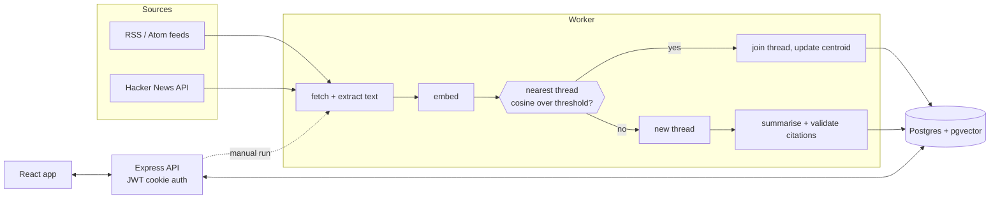

# News Funnel

A tech news feed that groups coverage of the same event into one story, summarises it from the article text, and ranks stories against what you follow. Every ranking and every summary line can be traced back: the story page shows the score breakdown and the exact source sentences behind each claim.

Built with React, TypeScript, Express and Postgres (pgvector).

## What it does

- **Ingests** RSS/Atom feeds and the Hacker News front page on a schedule, extracts article text, and skips URLs it has already seen.
- **Clusters** articles into story threads using embedding similarity. Fourteen outlets covering one announcement become one row with a timeline, not fourteen rows.
- **Summarises with citations.** Each summary bullet points at numbered sentences from the article. A validator rejects bullets whose numbers or wording are not supported by the cited text, and falls back to extractive summaries when a model fails the check.
- **Ranks per reader** from followed topics (by meaning, not only keywords), recency, how many outlets cover the story, source weight, and a taste vector learned from thumbs up and down.
- **Explains itself.** The story page lists each ranking component with its points and shows the passage that best matches your topic.
- **Team digests.** Teams are defined by topics; each gets a digest page and a Markdown export.
- **Admin tools.** Add or disable sources, adjust weights, trigger a fetch, see run history and per-source errors. The first account to register becomes admin.

## Architecture



| Piece | Where | Notes |
| --- | --- | --- |
| Schema | `server/migrations/001_init.sql` | Plain SQL migrations, tracked in `schema_migrations` |
| Ingest pipeline | `server/src/pipeline/` | Fetchers, clustering, summaries, orchestration with an advisory lock so two runs never overlap |
| Ranking | `server/src/ranking/` | Pure scoring functions, separate from the SQL that loads candidates |
| Embeddings | `server/src/providers/embeddings.ts` | `local` (MiniLM through transformers.js, no key needed), `gemini`, or `hash` (offline, used by tests) |
| API | `server/src/routes/` | zod validation, centralised error handler |
| Frontend | `client/src/` | React Router, a small fetch wrapper, no UI kit |

## Running it

Requirements: Node 22+, Docker.

```bash
cp .env.example .env
docker compose up -d db
cd server && npm ci && npm run migrate && npm run seed
npm run ingest          # first fetch, about 30 seconds (downloads the embedding model once)
npm run dev             # API on :3001

# in another terminal
cd client && npm ci && npm run dev    # app on :5173
```

Register an account in the UI. The first one is the admin.

Everything in containers instead:

```bash
docker compose up --build    # app on http://localhost:3001
```

The `worker` service refreshes feeds every `INGEST_INTERVAL_MINUTES`.

### Using Gemini

Set `GEMINI_API_KEY` in `.env`, then `EMBEDDING_PROVIDER=gemini` and/or `SUMMARY_PROVIDER=gemini`. Embeddings are requested at 384 dimensions so the schema is the same for both providers. Vectors from different models are not comparable, so after switching the embedding provider run `npm run reembed`.

## Tests

```bash
cd server && npm test      # needs the db container; creates a funnel_test database
cd client && npm test
```

The server suite covers URL normalisation, the SSRF guard, summary validation and fallback, clustering behaviour against a real Postgres, ranking maths, and the HTTP API (auth, roles, feed, feedback, digests). CI runs both suites against a pgvector service container.

Two bugs were caught by these tests while building (URL trailing-slash handling and a taste vector that failed to cancel out), which is a decent argument for writing them early.

## Ranking evaluation

`npm run eval` ranks a small labeled set for three reader profiles and reports precision@10 and mean average precision for a keyword baseline, embeddings alone, and the hybrid score used by the app.

On the bundled fixture with the local MiniLM model:

| | keyword | embedding | hybrid |
| --- | --- | --- | --- |
| mean P@10 | 0.53 | 0.87 | 0.87 |
| mean MAP | 0.61 | 0.86 | 0.86 |

Caveats worth knowing: the fixture is only 50 hand-written headlines, so treat these as a sanity check, not a benchmark. Several relevant items deliberately avoid the profile's exact words, which favours embeddings. The keyword signal adds nothing on top of embeddings here. To evaluate on real data, run `npm run eval:export`, label `server/eval/export.json`, and run `npm run eval -- --file eval/export.json`.

## Design decisions

- **Postgres with pgvector** instead of a separate vector store: threads, articles, feedback and vectors live in one transactional database, and nearest-thread lookup is a single indexed query.
- **Clustering against thread centroids**, updated as a running mean, so a story that develops over a day keeps collecting related articles without comparing every pair.
- **Citations are checked, not trusted.** The validator requires every number in a bullet to appear in the cited sentences and most of its content words to be supported. It is a heuristic and will not catch every paraphrase error, but it catches invented figures and unsupported claims, and the rejections are shown in the UI.
- **SSRF protection.** Source URLs and redirects are resolved and refused if they point at private or link-local addresses.
- **Cookie sessions.** JWT in an httpOnly, SameSite=Lax cookie, so scripts on the page cannot read it.
- **Ranking is a transparent weighted sum**, not a learned model. It is easy to inspect, and the weights live in one object in `ranking/score.ts`.

## Known limits

- No password reset or email verification.
- Summaries describe the lead article of a thread, not a synthesis across outlets.
- Paywalled pages that return little text are skipped.
- One embedding model per deployment; the thresholds in `.env.example` are tuned for MiniLM.
